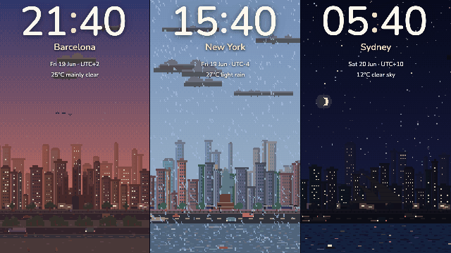
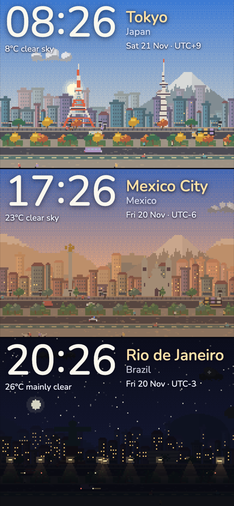
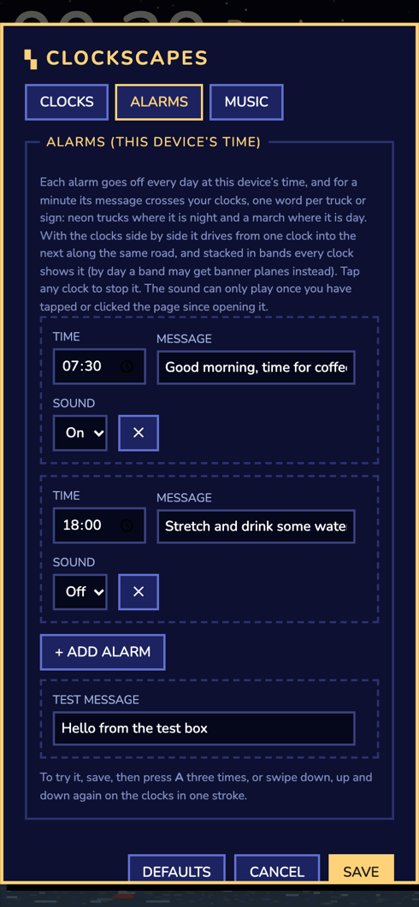
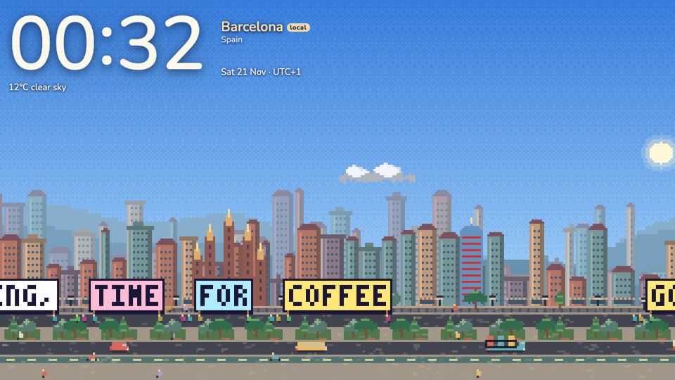
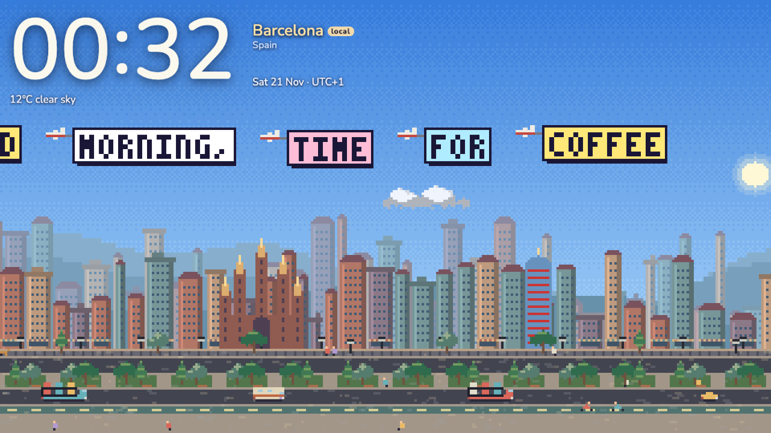
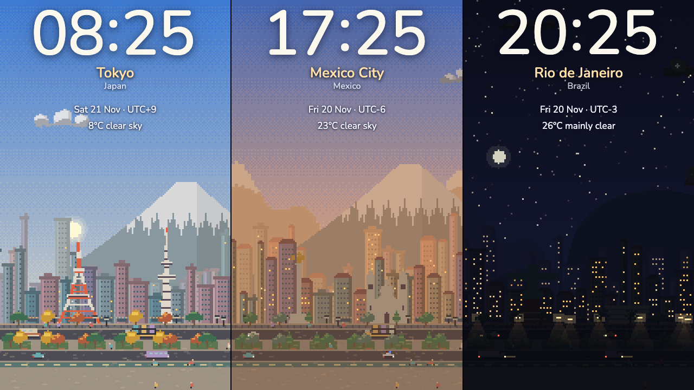

# clockscapes

Clockscapes shows up to four clocks in different time zones, each one over a pixel-art city lit by the real sun and the real weather there. It's meant as a cozy screensaver or an extra screen on your desk.

I asked an LLM to code this because I had a simple need: a cozy screen with clocks in several time zones. It is simple, it is one file, and I find it useful, so enjoy it.

## Use it

Open **https://utopick.github.io/clockscapes/** in any browser. You can also download `index.html` and open it, since the whole app is that one file.

From the live page you can install it as an app (Add to Home screen on a phone, or the install button in the address bar on a computer). It then opens full screen and works offline, apart from the weather.

On a phone held upright the clocks stack in rows, with each clock beside its city name.

## Android app

There is also an Android app for phones, tablets and TVs (Android TV and Google TV). It shows the same page, with a few extras that only an app can do. The APK is attached to each [release](https://github.com/utopick/clockscapes/releases), and it isn't on the Play Store, so you install it by hand:

1. Download the APK on the device, or copy it there on a USB stick. On a TV, the Downloader app or "Send Files to TV" are the easiest ways to get it there.
2. Open it, and allow the app you opened it with to install unknown apps when Android asks.
3. To update it later, install the new APK over the old one. Your settings stay.

On a phone, **SET AS WALLPAPER** in the SCREEN tab puts the clocks on your home and lock screen as a live wallpaper. On a TV the app sits in the apps row, the remote moves around it as described under [Keys](#keys), and you can pick Clockscapes as the TV's screensaver in its screensaver settings (the screensaver is silent).

The music behaves like any music app. On a phone it keeps playing in the background with a notification to stop or skip it, it stops when another app starts playing, and it pauses for a call and comes back when the call is over. On a TV it stops when you leave the app.

In the app, the music plays with the app's own native sound engine instead of the browser's. The songs are the same, but it uses far less of the phone's processor, so it doesn't crackle on an old phone or a TV and barely touches the battery with the screen off. The MUSIC tab's **Sound engine** setting can switch back to Web Audio.

## What it does

- Each city has its own scene, with its landmarks, local trees, the mountains you can see from it, traffic, people with the odd dog, boats, trains, planes and birds. Ferris wheels such as the London Eye turn, and lighthouses sweep their beams at night. The light follows the real sun and moon, and the sky follows the live weather, so people open umbrellas when it rains there. Drizzle, rain, freezing rain that glazes the street, storms with or without bouncing hail, snow, snow grains and fog each look different, and so do haze, desert dust and smoke in the air. A rainbow shows when the sun comes out after rain, and on clear nights in the far north or south an aurora sometimes dances (Open-Meteo has no aurora forecast, so that one is a guess that grows likelier nearer the pole). Trees follow the local season, bare in winter, in blossom in spring and orange in autumn.
- Every city has the same street, so clocks side by side line up: a sidewalk, a road, a strip of park and a second road, then a railway inland or the water in coastal and river cities. Bigger cities have overhead wires and a station where the trains stop for travellers.
- How many people and cars a city has depends on its real population, in four levels from few people to super crowded.
- The streets follow each city's own week. Roads fill up in the weekday rush hours, people stroll at weekends, Friday and Saturday nights get busy with people going out, and the small hours are quiet.
- On a city's holiday or local festival, such as Thanksgiving, Carnaval or Las Fallas, a small plane tows the festival's name across that clock every 15 minutes, and that night there are fireworks.
- Many cities have their own real events at their own time, and every city over four million people has at least one. Austin's bats pour out from under the Congress Avenue Bridge at dusk, starlings swirl over Rome on winter evenings, the Eiffel Tower sparkles on the hour after dark, Big Ben strikes the hour, Bangkok's streets stand still for the anthem at 8 am and 6 pm, kites fill Ahmedabad's sky for Uttarayan, Taipei's garbage truck comes by playing Für Elise, and Chinese cities go square dancing in the evening. Some holidays have their own, too. On 5 January, Spanish cities hold the Cabalgata de Reyes from 9:00 to 18:00, as Madrid's goes down the Castellana: the giant Star leads, then heralds on horseback, a toy train, the Royal Postman's mailbox for the children's letters, pages with camels, and Melchor, Gaspar and Baltasar on their thrones throwing sweets, under confetti and fireworks. That night until 8:00 the Three Kings ride their camels across the sky after the star. Cities with a carnival, such as Rio, Venice, Cologne, Basel, Cádiz, Tenerife and Barranquilla, hold their parade on its days from 10:00 to 20:00, each in its own style (samba feathers, Venetian masks, jesters, or New Orleans' Mardi Gras beads in purple, green and gold). In the Lunar New Year, Chinese cities, Hong Kong, Macau, Taiwan, Singapore and Malaysia hang red lanterns over the street on New Year's Eve and set off firecrackers and fireworks, and on the day a parade comes by with the dragon dance and two dancing lions. Madrid has its own year too: the Rastro flea market on Sunday mornings, the Changing of the Guard on Wednesdays and Saturdays, puppets, bubbles and music in the park at weekends, the chotis on San Isidro, the Pride parade in July, the shepherds driving their sheep through the centre for the Trashumancia in October, the Christmas lights and the Naviluz bus from late November, and on New Year's Eve the ball dropping on the Puerta del Sol clock before the twelve chimes, with a grape for each one. Seville has its Feria de Abril, with casetas, farolillos, sevillanas and horse carriages, and its Holy Week processions. Logroño has San Mateo's giants and grape treading, the fish and wine of San Bernabé and weekend evenings on Calle Laurel. Vigo has its giant Christmas lights and the procession of the Cristo da Vitoria. Holy Week looks different in each city: Málaga's tronos and the Legion, Zamora's soft hoods, drums and the Merlú at dawn, Valladolid's carved groups, Cartagena's red Californios and purple Marrajos, Madrid's processions and the Medinaceli queue, and the purple cucuruchos of Guatemala walking over sawdust carpets, Quito, Popayán and Cusco's Lord of the Earthquakes. Valencia has its Fallas, from the daily mascletà to the Cremà, and Barcelona and Tarragona build castells. When a city has a holiday, its name shows under the date. Where the call to prayer is heard, it sounds five times a day at the real prayer times, worked out from the sun. On Christmas Eve, from 18:00 until 8:00 the next morning, Santa's sleigh replaces the planes over American cities and drops presents, and on Thanksgiving New York has its parade of giant balloons from 9:00 to 18:00. At midnight on New Year's Eve every city hears the bells strike twelve, and fireworks fill the sky for an hour while a plane tows "Happy New Year" with the new year's number. Some have a sound too, which plays through the music when it's on. To see them without waiting, press **E** three times (or swipe left, right, left and right on the clocks). Each time you do it again, the next event of the cities on screen shows, and after the last one a message says the events are back to their real times.
- Lo-fi music is made live in the page from your clocks, so each city and hour gives a different song, and the place plays along, muffled like a lo-fi field recording: voices and traffic as busy as the city and the hour, a train passing now and then, birds by day, crickets on warm nights, waves in coastal cities, wind when it's windy, and rain with drops on the window and distant thunder in a storm. **City sounds** in the MUSIC tab switches them off. To see and hear every kind of weather anywhere, press **R** three times (or swipe up, down, up and down on the clocks). Each time you do it again, every city shows the next one, from rain through hail, snow, fog, dust and smoke to a rainbow and an aurora, and after the last one the real weather comes back.
- Daily alarms carry a short message across your clocks for a minute, as explained [below](#alarms).
- A screen filter can make the clocks look like an old CRT television or an LCD screen, as shown [below](#screen-filters).
- Settings stay in this browser only. The only thing the page talks to is [Open-Meteo](https://open-meteo.com/), for the weather, the air quality (which shows dust and smoke) and the place search, and you can switch the weather off.

## Pick your cities

You can show one to four clocks. Press **S** (or tap the screen, then **⚙ SETTINGS**) and use the **CLOCKS** tab:

1. Under Zones, pick a **Country** and then a **City** from about 3,000 cities, so a TV remote can do it too: every national and regional capital, the province capitals of Spain, Italy and France, and every city of a million people or more. That fills in its time zone, coordinates and scene.
2. For a place that isn't in the list, open **Other place**, type its name in **Label** and press **FIND**, or type the time zone and coordinates yourself. It then gets a regional street scene.
3. Press **+ ADD ZONE** for another clock, or **RANDOMIZE 3 CITIES** for a surprise, then **SAVE**.

The same tab sets the layout (side by side, stacked, or automatic), a 24 or 12 hour clock, °C or °F, and whether to fetch the live weather. With the weather off, the scenes still follow day and night.

## Music

Press **▶︎ MUSIC** (or **M**) to play lo-fi music made live in the page, and **NEXT »** (or **N**) to skip a song. Browsers only allow sound after you've touched or clicked the page once. Each song comes from one of your clocks in turn, so its city and hour pick the song and its sun sets the mood, slower and darker at night. Each song also picks one of ten bands, such as a felt piano with a long echo, a jazz trio with vibraphone, a Rhodes with a clean jazz guitar, a Wurlitzer with a kalimba and claps, a marimba over a ticking clock kit, or a music box and someone whistling, and its tunes change a little when a part comes back. Each song grows from a small musical gene, three moves that shape its melody, its chords and how its second part moves away from the first, so the same idea shows at every size, and the seed also picks the tempo, the chord colour and the order of the parts. The **MUSIC** tab in settings has the volume and a variation number, which gives you a new set of songs when you change it. With **Regional music** on, as it is at first, the songs take the style of the place on your first clock while staying lo-fi. Seville and the rest of Andalusia get flamenco, with a guitar strumming rasgueados over the Andalusian cadence, palmas and castanets, and Galicia, Asturias, Scotland, Wales, Ireland, Brittany and the Isle of Man get a Celtic lilt in Dorian or Mixolydian, with bagpipes or a tin whistle playing quick grace notes over a drone and a bodhrán (the pandeireta in Galicia). New Orleans has jazzy soul with a muted trumpet or a sax, Berlin and Detroit a mellow lo-fi techno, Japan a shakuhachi over koto plucks and taiko, and many other countries their own touch, such as the dulzaina and tamboril of La Rioja, the oud and darbuka of the Arab world, or a tanpura drone and tabla in India. Portugal plays fado, slow and moving between minor and major, with the trembling Portuguese guitar or a wordless voice over a classical guitar's arpeggios. Rio, São Paulo and most of Brazil play bossa nova on a nylon guitar with ninth chords, brushes and a shaker, and the north-east plays forró with an accordion and a triangle. Texas and Nashville get a mellow lo-fi country with a pedal steel or a fiddle, a twangy guitar on the backbeat and the train beat on brushes. Iran, Azerbaijan, Uzbekistan and Tajikistan play a Persian style with santur rolls and the tombak, and the steppe from Kazakhstan to Mongolia a galloping dombra under a throat-sung drone. Argentina and Uruguay play tango, Colombia and its neighbours cumbia, the Andes a quena over a charango, Jamaica reggae, much of Africa afrobeat, the Balkans a clarinet and accordion, and Russia, Ukraine and Belarus Slavic folk. Places without a style of their own, and every place with the box unticked, play the usual lo-fi. When a giant monster walks through a clock, the music fades into a slow, heavy tread in the spirit of the old 1950s and 60s monster films, and fades back into lo-fi once it has gone. A stubborn low ostinato in the strings and a piano repeats under blunt brass in fifths and octaves, timpani and a big drum fall on every beat like footsteps, and a gong opens each section. Every section starts with the same three-note brass motto, Clockscapes' own monster signature, and each phrase ends on a sour stab. All of it was written for this page and doesn't copy any film's music. The music is played by a small engine written in C, which runs natively in the Android app and as WebAssembly in a browser, on an audio thread of its own. Because each song is handed over whole, a busy or hidden page can't leave gaps in it. The **Sound engine** setting can switch to Web Audio, the original engine, which plans the notes from the page as they come.

## Alarms

Alarms are daily reminders that show up in the scenery instead of ringing. Here's how to set one:

1. Press **S** (or tap the screen, then **⚙ SETTINGS**) to open settings, then open the **ALARMS** tab.
2. Press **+ ADD ALARM**, pick a time and write a message of up to 36 characters.
3. Choose whether it plays a soft arpeggio (SOUND On or Off), then press **SAVE**.

The time is this device's own time, whatever cities your clocks show. The page has to be open for an alarm to go off, and the sound only plays once you've tapped or clicked the page since opening it.

When the alarm goes off, the message crosses your clocks for a full minute, one word per vehicle or sign, and repeats until the minute is over. Tap any clock to stop it. How it looks depends on the time of day in each city:

| At night | By day | By day, sometimes |
|---|---|---|
|  |  |  |
| Neon trucks drive along the road | People march holding signs | Planes tow banners across the sky |

With the clocks side by side, the message drives from one clock into the next along the same road, turning from trucks into a march where the city crosses from night to day, as in the animation at the top. When the clocks are stacked in rows, as on a phone, every clock shows the whole message.

To try it without waiting, write something in the **TEST MESSAGE** box, save, and press **A** three times. On a touch screen, swipe down, up and down again on the clocks, and on a TV remote press Up six times.

## Screen filters

The **SCREEN** tab in settings can lay a filter over the clocks. CRT makes each clock look like a small tube television, with scanlines, glowing colours and dark rounded corners. LCD shows the thin gaps between the pixels of a handheld screen. Pick one and press **SAVE**.

| CRT television | LCD screen |
|---|---|
|  |  |

## Battery and screen care

The same SCREEN tab has three settings for leaving the clocks up for hours. **Battery saver** draws 5 frames a second instead of 15, so a phone stays cooler, and turning off **Keep the screen on** lets the screen dim and sleep as usual, which saves the most. **Burn-in protection**, on by default, keeps OLED screens safe: the picture moves by a pixel or two every 2 minutes so no pixel shows the same thing for hours, and a soft line sweeps down the screen every 10 minutes.

## Keys

| Key | What it does |
|---|---|
| **S** | Opens settings (cities, alarms, music, screen filter) |
| **F** | Full screen |
| **M** | Music on or off |
| **N** | Next song |
| **R** three times | The next kind of weather in every city (rain, drizzle, freezing rain, storm, hail, snow, snow grains, fog, haze, dust, smoke, rainbow, aurora), then the real weather again (on a touch screen, swipe up, down, up and down) |
| **E** three times | The next city event of the cities on screen, then the events at their real times again (on a touch screen, swipe left, right, left and right) |
| **A** three times | Plays the test alarm from the ALARMS tab (on a touch screen, swipe down, up and down again) |
| **Esc** | Closes settings |

On a touch screen, tap to show the buttons. With a TV remote, the arrows move between the buttons and the settings, OK presses, Back closes settings, and the remote's play and next keys control the music. Left, Right, Left, Right on the clocks is the event test. A text box only opens the TV's keyboard once you press OK on it, so moving through settings doesn't keep popping it up. There are a few easter eggs too. **K**eep poking and you'll maybe find some.

## For developers

Everything about how it works, how to run it, change it and fix it is in the [manual](docs/MANUAL.md).

## Credits

- Font: [Nunito](https://github.com/googlefonts/nunito), SIL Open Font License 1.1, embedded in the page.
- Capital coordinates adapted from [countries_cities_data](https://github.com/katerinaSo/countries_cities_data). The other cities and the populations come from [GeoNames](https://www.geonames.org/) (CC BY 4.0), and the coastline used to find coastal cities from [Natural Earth](https://www.naturalearthdata.com/) (public domain). How the list was built is in [tools/atlas](tools/atlas/README.md).
- Weather data by [Open-Meteo.com](https://open-meteo.com/), under [CC BY 4.0](https://creativecommons.org/licenses/by/4.0/). The place search uses Open-Meteo's geocoding, which is based on [GeoNames](https://www.geonames.org/) (CC BY 4.0). The page shows this credit above its buttons, and the **LICENSE** tab in settings has the details.
