# clockscapes

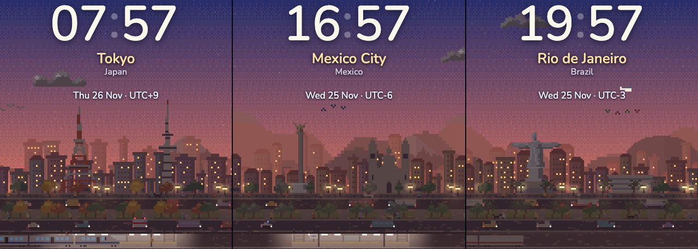

Clockscapes shows up to four clocks in different time zones, each over a pixel-art city lit by the real sun and weather there. It's meant as a cozy screensaver or an extra screen on your desk, and it plays lo-fi music made from your cities.

## Use it

Open **https://utopick.github.io/clockscapes/** in any browser, or install it from there as an app. It's one file, it collects nothing about you ([privacy policy](https://utopick.github.io/clockscapes/privacy.html)), and it only talks to [Open-Meteo](https://open-meteo.com/) for the weather.

There is also an Android app, attached to each [release](https://github.com/utopick/clockscapes/releases). On a phone it can be your live wallpaper, and on Android TV and Google TV it can be your screensaver. With Android Auto it fills the car's screen with your cities:

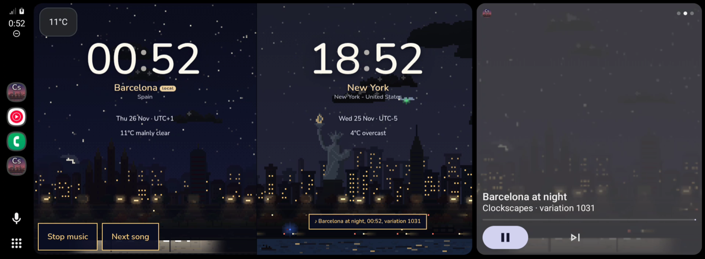

## What it does

Each of about 3,000 cities has its own landmarks, traffic and people, and the sky follows the live weather, from rain and snow to a rainbow or an aurora.

<table>
<tr>
<td width="50%"></td>
<td width="50%"></td>
</tr>
</table>

Cities also have their own events at their real times, such as Austin's bats at dusk, carnival in Rio or the Three Kings in Madrid.

<table>
<tr>
<td width="33%">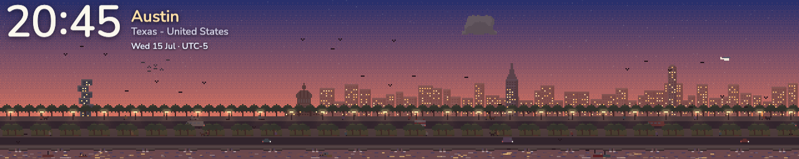</td>
<td width="33%">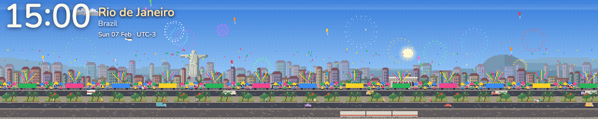</td>
<td width="33%"></td>
</tr>
</table>

The music is made live from your clocks, so each city and hour gives a different song, often in the style of the place. Listen to [Seville](https://utopick.github.io/clockscapes/audio/seville.mp3), [Lisbon](https://utopick.github.io/clockscapes/audio/lisbon.mp3), [Rio](https://utopick.github.io/clockscapes/audio/rio-de-janeiro.mp3), [Tokyo](https://utopick.github.io/clockscapes/audio/tokyo.mp3), [New Orleans](https://utopick.github.io/clockscapes/audio/new-orleans.mp3) or [Edinburgh](https://utopick.github.io/clockscapes/audio/edinburgh.mp3).

Alarms carry your message across the clocks instead of ringing, and twelve screen filters make it look like an old TV, a Game Boy or a terminal. Here is Mexico City at noon through each of them, and three of them at night:

<table>
<tr>
<td width="33%"> Clean</td>
<td width="33%"> CRT television</td>
<td width="33%">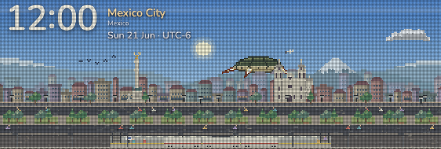 LCD screen</td>
</tr>
<tr>
<td> Game Boy</td>
<td>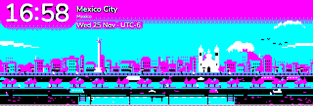 CGA</td>
<td>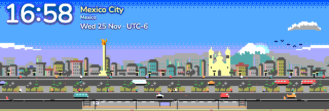 EGA</td>
</tr>
<tr>
<td> Monochrome</td>
<td> Sepia</td>
<td>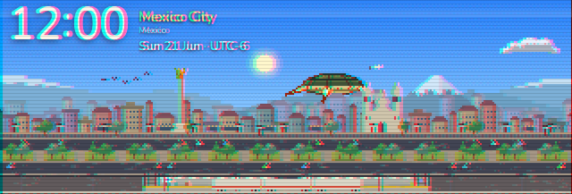 VHS</td>
</tr>
<tr>
<td> Amber terminal</td>
<td>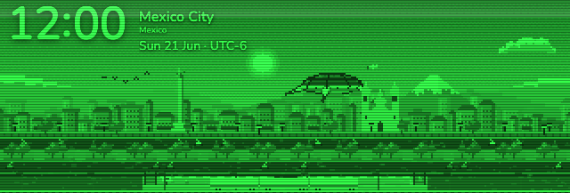 Green terminal</td>
<td> Night red</td>
</tr>
</table>

<table>
<tr>
<td width="33%">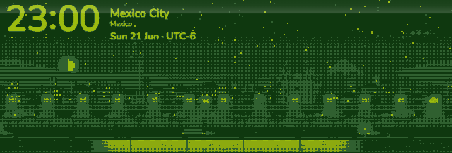 Game Boy at night</td>
<td width="33%">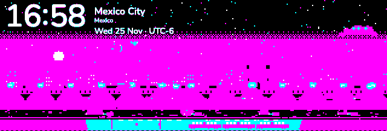 CGA at night</td>
<td width="33%"> Green terminal at night</td>
</tr>
</table>

## Settings and keys

Press **S** (or tap the screen, then **⚙ SETTINGS**) to pick your cities, set alarms, change the music and choose a filter. **M** plays the music, **N** skips a song and **F** goes full screen.

Everything else, from every event and music style to the keys, the TV remote and the battery settings, is in the [full guide](docs/GUIDE.md). How it works inside is in the [manual](docs/MANUAL.md).

There are a few easter eggs too, so keep po**K**ing.

## Credits

- Font: [Nunito](https://github.com/googlefonts/nunito), SIL Open Font License 1.1.
- Recorded bagpipe and Spanish guitar from [FreePats](https://freepats.zenvoid.org/) and the grand piano from Versilian Studios' [VCSL](https://github.com/sgossner/VCSL), all CC0 1.0.
- Cities and populations from [GeoNames](https://www.geonames.org/) (CC BY 4.0) and [countries_cities_data](https://github.com/katerinaSo/countries_cities_data), and the coastline from [Natural Earth](https://www.naturalearthdata.com/).
- Weather data by [Open-Meteo.com](https://open-meteo.com/) (CC BY 4.0).
