# Clockscapes, the full guide

This is everything Clockscapes does, in detail. The [README](../README.md) has the short version.

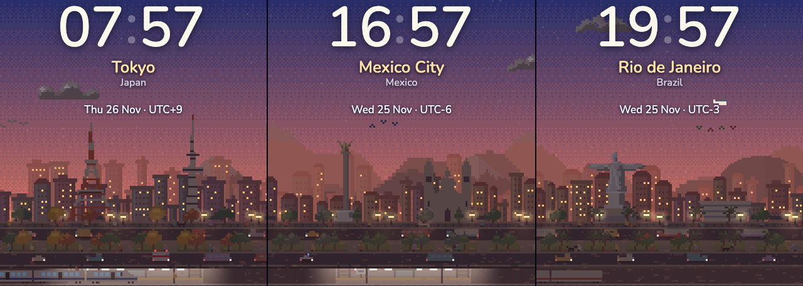

Clockscapes shows up to four clocks in different time zones, each one over a pixel-art city lit by the real sun and the real weather there. It's meant as a cozy screensaver or an extra screen on your desk.

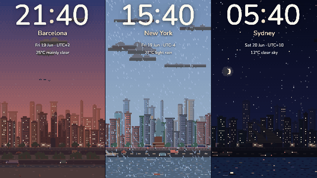

I asked an LLM to code this because I had a simple need: a cozy screen with clocks in several time zones. It is simple, it is one file, and I find it useful, so enjoy it.

## Use it

Open **https://utopick.github.io/clockscapes/** in any browser. You can also download `index.html` and open it, since the whole app is that one file.

From the live page you can install it as an app (Add to Home screen on a phone, or the install button in the address bar on a computer). It then opens full screen and works offline, apart from the weather.

Clockscapes collects nothing about you, and its [privacy policy](https://utopick.github.io/clockscapes/privacy.html) says what is sent to the weather service.

On a phone held upright the clocks stack in rows, with each clock beside its city name. Each city has its own light, so here are the same three cities at three moments of one day:

<table>
<tr>
<td width="33%">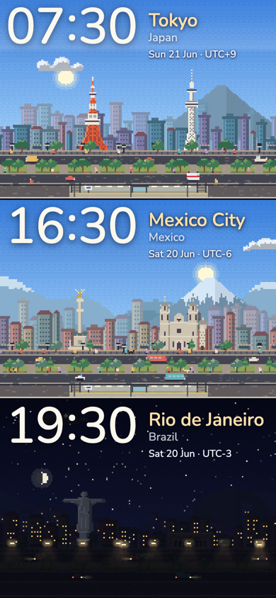 Morning in Tokyo, afternoon in Mexico City and nightfall in Rio</td>
<td width="33%">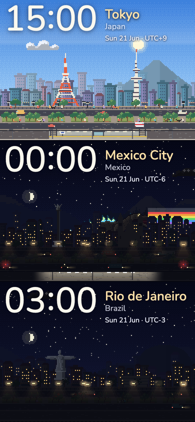 Afternoon in Tokyo, night in the Americas</td>
<td width="33%">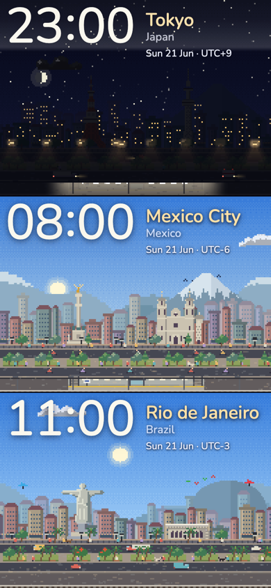 Night in Tokyo, morning in the Americas</td>
</tr>
</table>

## Android app

There is also an Android app for phones, tablets and TVs (Android TV and Google TV). It shows the same page, with a few extras that only an app can do. The APK is attached to each [release](https://github.com/utopick/clockscapes/releases), and it isn't on the Play Store yet, so you install it by hand:

1. Download the APK on the device, or copy it there on a USB stick. On a TV, the Downloader app or "Send Files to TV" are the easiest ways to get it there.
2. Open it, and allow the app you opened it with to install unknown apps when Android asks.
3. To update it later, install the new APK over the old one. Your settings stay.

On a phone, **SET AS WALLPAPER** in the SCREEN tab puts the clocks on your home and lock screen as a live wallpaper. On a TV the app sits in the apps row, the remote moves around it as described under [Keys](#keys), and you can pick Clockscapes as the TV's screensaver in its screensaver settings (the screensaver is silent).

The music behaves like any music app. On a phone it keeps playing in the background with a notification to stop or skip it, it stops when another app starts playing, and it pauses for a call and comes back when the call is over. On a TV it stops when you leave the app.

In the app, the music plays with the app's own native sound engine instead of the browser's. The songs are the same, but it uses far less of the phone's processor, so it doesn't crackle on an old phone or a TV and barely touches the battery with the screen off. The MUSIC tab's **Sound engine** setting can switch back to Web Audio.

### In the car

With Android Auto, Clockscapes fills the car's screen with your cities standing side by side. Android Auto always keeps a small card in a corner, so Clockscapes uses it for the temperature of your first clock.

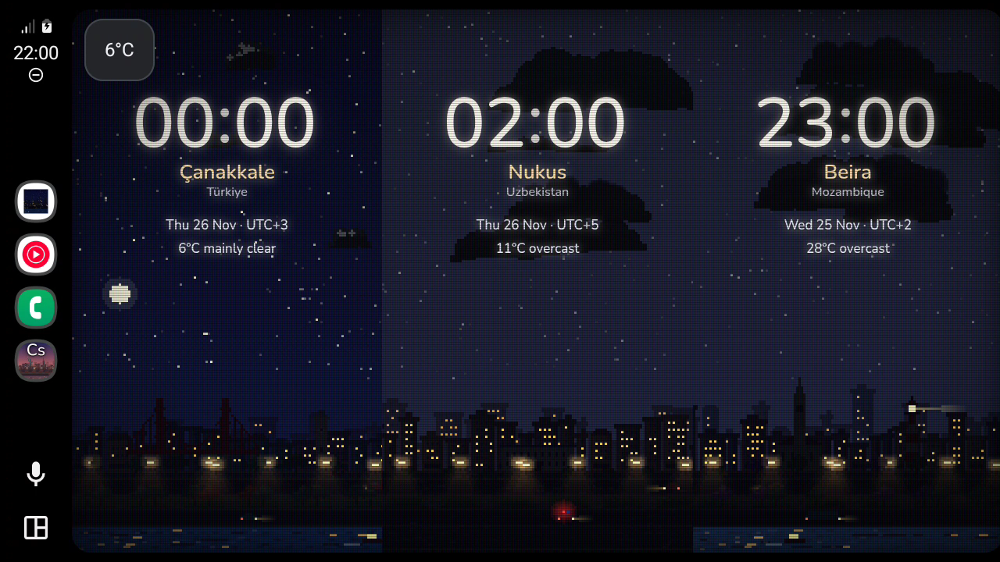

Tap the scene and **Play music** and **Next song** show at the lower left for ten seconds. While the music plays, Android Auto's media card shows the song's name, with the scene of your local city (or your first clock's city) as its picture, and its own pause and skip buttons work too.

## What it does

### The cities

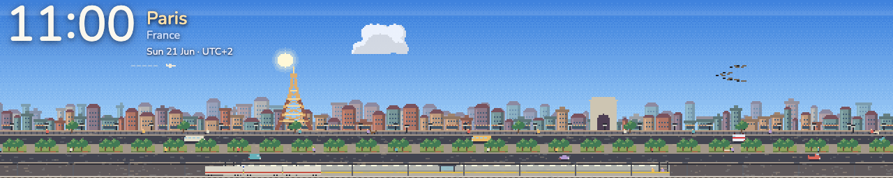

Each city has its own scene, with its landmarks, local trees, the mountains you can see from it, traffic, people with the odd dog, boats, trains, planes and birds. Ferris wheels such as the London Eye turn, and lighthouses sweep their beams at night.

Every city has the same street, so clocks side by side line up. There is a sidewalk, a road, a strip of park and a second road, then a railway inland or the water in coastal and river cities. Bigger cities have overhead wires and a station where the trains stop for travellers.

How many people and cars a city has depends on its real population, in four levels from few people to super crowded. The streets also follow each city's own week, so roads fill up in the weekday rush hours, people stroll at weekends, Friday and Saturday nights get busy with people going out, and the small hours are quiet.

### Sun, sky and weather

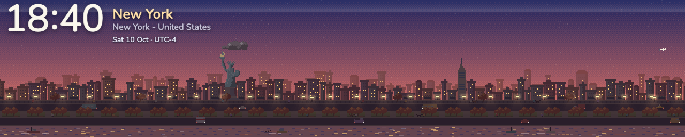

The light follows the real sun and moon, and the sky follows the live weather, so people open umbrellas when it rains there. Drizzle, rain, freezing rain that glazes the street, storms with or without bouncing hail, snow, snow grains and fog each look different, and so do haze, desert dust and smoke in the air.

A rainbow shows when the sun comes out after rain. On clear nights in the far north or south an aurora sometimes dances, although Open-Meteo has no aurora forecast, so that one is a guess that grows likelier nearer the pole. Trees follow the local season, bare in winter, in blossom in spring and orange in autumn.

<table>
<tr>
<td width="50%">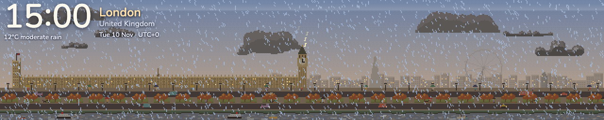 Rain in London</td>
<td width="50%">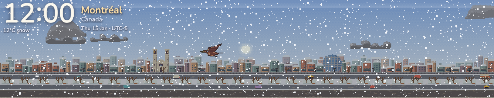 Snow in Montréal</td>
</tr>
<tr>
<td>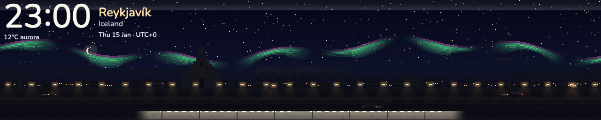 An aurora over Reykjavík</td>
<td>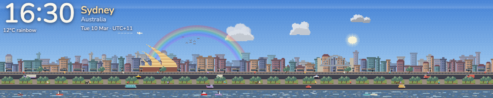 A rainbow over Sydney</td>
</tr>
</table>

To see every kind of weather anywhere, press **R** three times (or swipe up, down, up and down on the clocks). Each time you do it again, every city shows the next one, from rain through hail, snow, fog, dust and smoke to a rainbow and an aurora, and after the last one the real weather comes back.

### Holidays and city events

On a city's holiday or local festival, such as Thanksgiving, Carnaval or Las Fallas, a small plane tows the festival's name across that clock every 15 minutes, and that night there are fireworks. The holiday's name also shows under the date.

Many cities have their own real events at their own time, and every city over four million people has at least one. Austin's bats pour out from under the Congress Avenue Bridge at dusk, starlings swirl over Rome on winter evenings, the Eiffel Tower sparkles on the hour after dark and Big Ben strikes the hour. Bangkok's streets stand still for the anthem at 8 am and 6 pm, kites fill Ahmedabad's sky for Uttarayan, Taipei's garbage truck comes by playing Für Elise, and Chinese cities go square dancing in the evening. Where the call to prayer is heard, it sounds five times a day at the real prayer times, worked out from the sun.

<table>
<tr>
<td width="33%">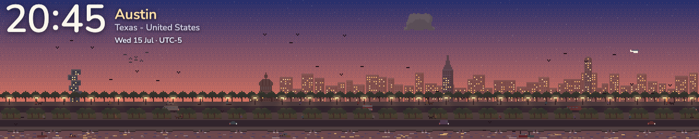 Austin's bats at dusk</td>
<td width="33%">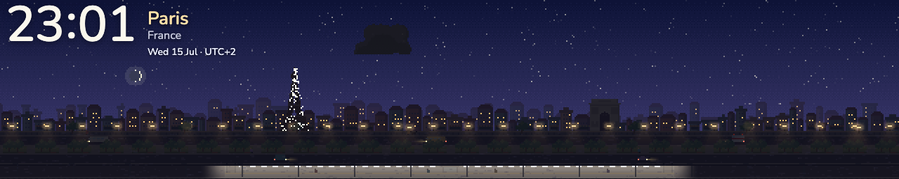 The Eiffel Tower sparkles on the hour</td>
<td width="33%">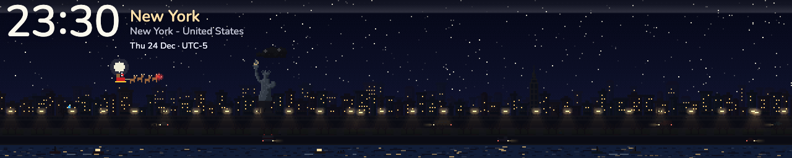 Santa over New York on Christmas Eve</td>
</tr>
<tr>
<td>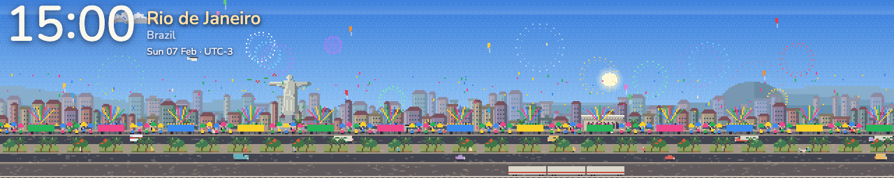 Carnival in Rio</td>
<td>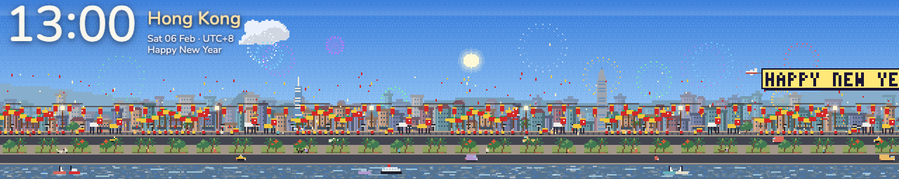 Lunar New Year in Hong Kong</td>
<td>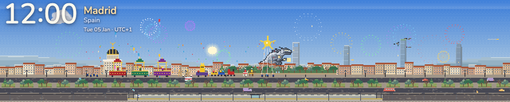 The Three Kings in Madrid</td>
</tr>
</table>

Some holidays have big parades:

- On 5 January, Spanish cities hold the Cabalgata de Reyes from 9:00 to 18:00, with the giant Star, heralds on horseback, the Royal Postman's mailbox, camels and the Three Kings on their thrones throwing sweets. That night the Kings ride their camels across the sky after the star.
- Cities with a carnival, such as Rio, Venice, Cologne, Basel, Cádiz, Tenerife and Barranquilla, hold their parade from 10:00 to 20:00, each in its own style, and New Orleans has its Mardi Gras beads.
- At Lunar New Year, Chinese cities, Hong Kong, Macau, Taiwan, Singapore and Malaysia hang red lanterns and set off firecrackers on New Year's Eve, and on the day a parade comes by with the dragon dance and two lions.
- On Christmas Eve Santa's sleigh replaces the planes over American cities, and on Thanksgiving New York has its parade of giant balloons.
- At midnight on New Year's Eve every city hears the bells strike twelve, and fireworks fill the sky for an hour.

Spanish cities have many of their own. Madrid has the Rastro on Sunday mornings, the Changing of the Guard, the chotis on San Isidro, the sheep of the Trashumancia in October and the grapes at the Puerta del Sol on New Year's Eve. Seville has its Feria de Abril, Valencia its Fallas, Barcelona and Tarragona build castells, and Holy Week looks different in each city, from Málaga's tronos to Zamora's drums at dawn, and on to Guatemala's sawdust carpets and Cusco's Lord of the Earthquakes.

Some events have a sound too, which plays through the music when it's on. To see them without waiting, press **E** three times (or swipe left, right, left and right on the clocks). Each time you do it again, the next event of the cities on screen shows, and after the last one a message says the events are back to their real times.

### The rest

Daily alarms carry a short message across your clocks for a minute, as explained [below](#alarms), and a screen filter can make the clocks look like an old television, a Game Boy or a terminal, as shown [below](#screen-filters).

Settings stay in this browser only. The only thing the page talks to is [Open-Meteo](https://open-meteo.com/), for the weather, the air quality (which shows dust and smoke) and the place search, and you can switch the weather off.

## Pick your cities

You can show one to four clocks. Press **S** (or tap the screen, then **⚙ SETTINGS**) and use the **CLOCKS** tab:

1. Under Zones, pick a **Country** and then a **City** from about 3,000 cities, so a TV remote can do it too. The list has every national and regional capital, the province capitals of Spain, Italy and France, and every city of a million people or more. Picking one fills in its time zone, coordinates and scene.
2. For a place that isn't in the list, open **Other place**, type its name in **Label** and press **FIND**, or type the time zone and coordinates yourself. It then gets a regional street scene.
3. Press **+ ADD ZONE** for another clock, or **RANDOM CITY** on a clock for a surprise city, then **SAVE**.

The SCREEN tab sets the layout (side by side, stacked, or automatic), a 24 or 12 hour clock, °C or °F, and whether to fetch the live weather. With the weather off, the scenes still follow day and night.

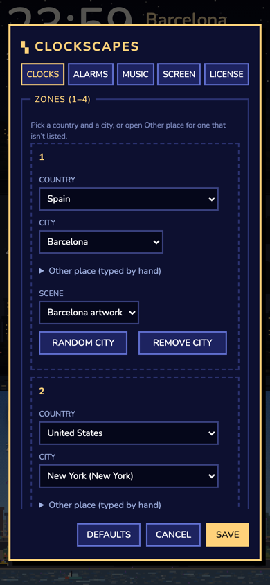
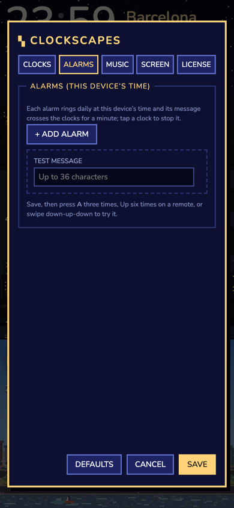
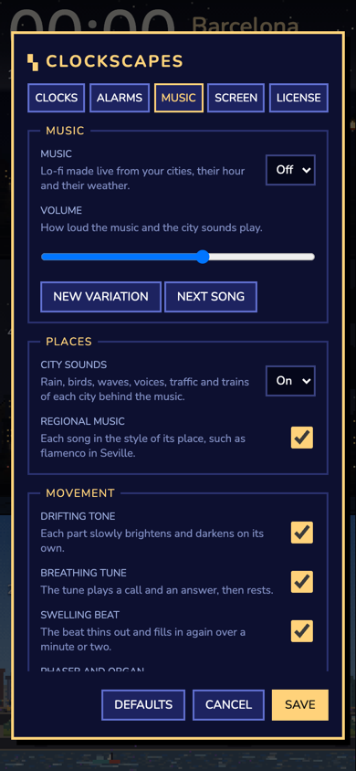
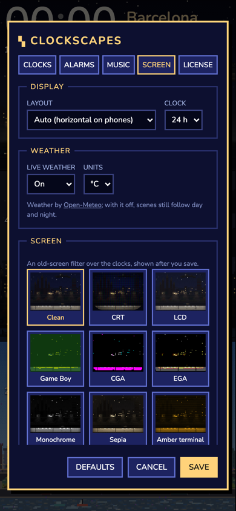

## Music

Press **▶︎ MUSIC** (or **M**) to play lo-fi music made live in the page, and **NEXT »** (or **N**) to skip a song. Browsers only allow sound after you've touched or clicked the page once.

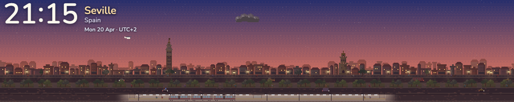

Here are half a minute of six songs, played by the app's own engine. Each link opens the song in your browser:

- [Seville, flamenco](https://utopick.github.io/clockscapes/audio/seville.mp3)
- [Lisbon, fado](https://utopick.github.io/clockscapes/audio/lisbon.mp3)
- [Rio de Janeiro, bossa nova](https://utopick.github.io/clockscapes/audio/rio-de-janeiro.mp3)
- [Tokyo, shakuhachi and koto](https://utopick.github.io/clockscapes/audio/tokyo.mp3)
- [New Orleans, jazzy soul](https://utopick.github.io/clockscapes/audio/new-orleans.mp3)
- [Edinburgh, a Celtic lilt](https://utopick.github.io/clockscapes/audio/edinburgh.mp3)

### Every song is different

Each song comes from one of your clocks in turn, so its city and hour pick the song and its sun sets the mood, slower and darker at night. Each song grows from a small musical gene, three moves that shape its melody, its chords and how its second part moves away from the first, and the seed also picks the tempo, the chord colour and the order of the parts.

Each song also picks one of ten bands. You might hear a felt piano with a long echo, a jazz trio with vibraphone, a Rhodes with a clean jazz guitar, a marimba over a ticking clock kit, or a music box with a low, singing voice like a theremin. The **MUSIC** tab has the volume and a variation number, which gives you a new set of songs when you change it.

### The sound of each place

With **Regional music** on, as it is at first, each song takes the style of the place it is about while staying lo-fi. Seville gets flamenco with rasgueados, palmas and castanets, Scotland and Ireland a Celtic lilt with bagpipes or a tin whistle, and Galicia a gaita band playing a muiñeira. Portugal plays fado, Brazil bossa nova and forró, Argentina tango, Colombia cumbia, Texas a mellow country with a pedal steel, Japan a shakuhachi over koto and taiko, India a tanpura drone and tabla, and many other places have their own touch.

Every style stays lo-fi underneath, so its tempo is relaxed, its drums are sparse and soft, and the tape sounds a little dark. Places without a style of their own, and every place with the box unticked, play the usual lo-fi.

The place also plays along, muffled like a lo-fi field recording. You hear voices and traffic as busy as the city and the hour, a train now and then, birds by day, crickets on warm nights, waves in coastal cities, wind, and rain with drops on the window and distant thunder in a storm. **City sounds** in the MUSIC tab switches them off.

When a giant monster walks through a clock, the music fades into a slow, heavy tread in the spirit of the old 1950s and 60s monster films, and fades back once it has gone. It was written for this page and doesn't copy any film's music.

### Four ways to play it

Four more boxes in the **MUSIC** tab, all ticked at first, change how every song is played without changing the song itself:

- **Drifting tone** makes the parts get slowly brighter and darker instead of louder and softer, and the whole song opens and closes over a few minutes.
- **Breathing tune** turns each section's tune into a short call and answer followed by two bars of rest.
- **Swelling beat** thins the beat out and fills it in again over a minute or two.
- **Phaser and organ** puts a slow phaser on the pads, adds a quiet organ under the chords and, when city sounds are on and it isn't raining, a soft bed of running water.

With all four unticked the music is exactly as it was before them.

The music is played by a small engine written in C, which runs natively in the Android app and as WebAssembly in a browser, on an audio thread of its own. Each song is handed over whole, so a busy or hidden page can't leave gaps in it. The **Sound engine** setting can switch to Web Audio, the original engine.

## Alarms

Alarms are daily reminders that show up in the scenery instead of ringing. Here's how to set one:

1. Press **S** (or tap the screen, then **⚙ SETTINGS**) to open settings, then open the **ALARMS** tab.
2. Press **+ ADD ALARM**, pick a time and write a message of up to 36 characters.
3. Choose whether it plays a soft arpeggio (SOUND On or Off), then press **SAVE**.

The time is this device's own time, whatever cities your clocks show. The page has to be open for an alarm to go off, and the sound only plays once you've tapped or clicked the page since opening it.

When the alarm goes off, the message crosses your clocks for a full minute, one word per vehicle or sign, and repeats until the minute is over. Tap any clock to stop it. How it looks depends on the time of day in each city:

| At night | By day | By day, sometimes |
|---|---|---|
| 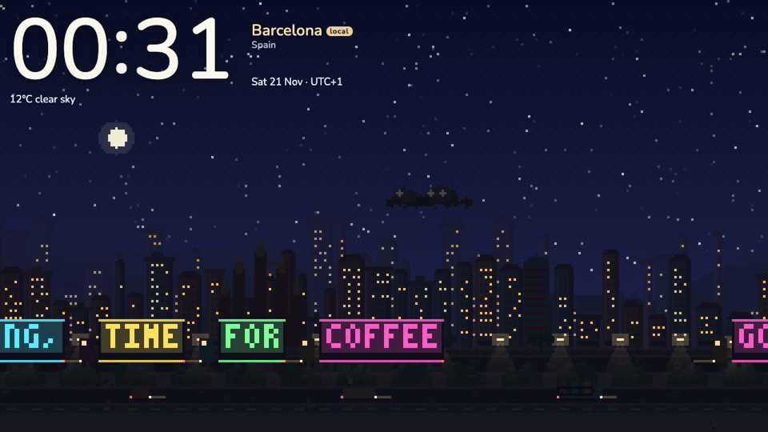 | 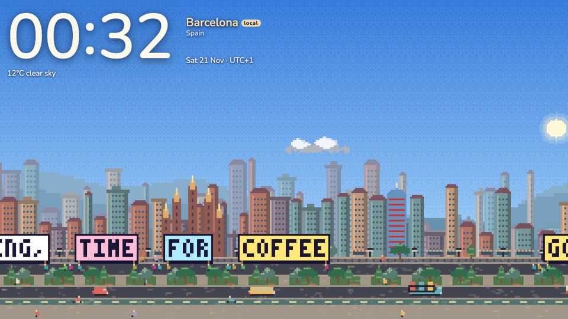 | 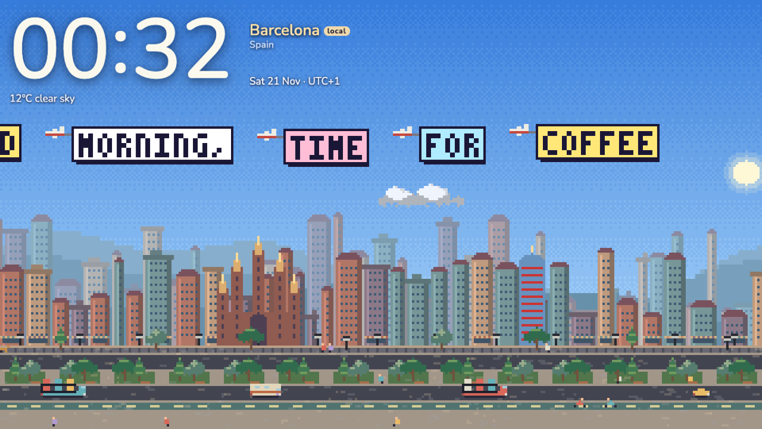 |
| Neon trucks drive along the road | People march holding signs | Planes tow banners across the sky |

With the clocks side by side, the message drives from one clock into the next along the same road, turning from trucks into a march where the city crosses from night to day, as in the animation at the top. When the clocks are stacked in rows, as on a phone, every clock shows the whole message.

To try it without waiting, write something in the **TEST MESSAGE** box, save, and press **A** three times. On a touch screen, swipe down, up and down again on the clocks, and on a TV remote press Up six times.

## Screen filters

The **SCREEN** tab in settings can lay a filter over the clocks, and each one shows as a small picture of your first clock through it. Tap one and press **SAVE**. Here is Mexico City by day through each of them:

<table>
<tr>
<td width="33%">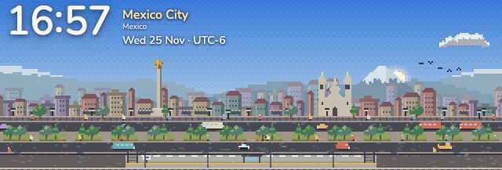 Clean</td>
<td width="33%">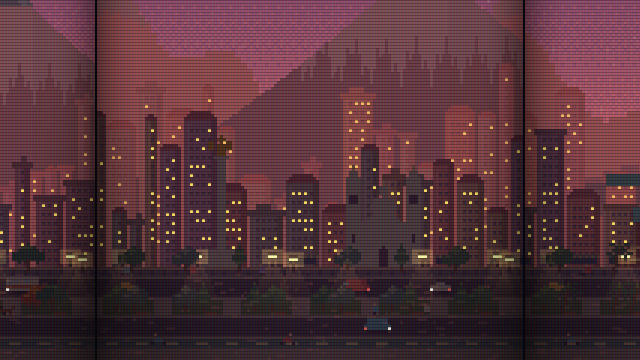 CRT television</td>
<td width="33%">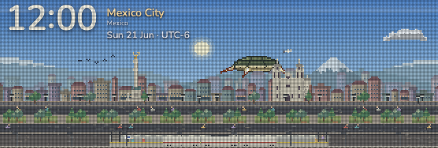 LCD screen</td>
</tr>
<tr>
<td>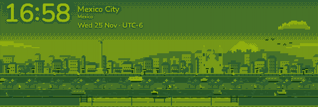 Game Boy</td>
<td>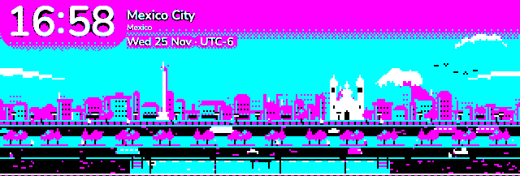 CGA</td>
<td>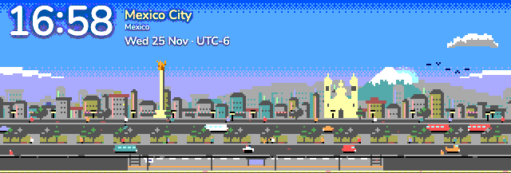 EGA</td>
</tr>
<tr>
<td>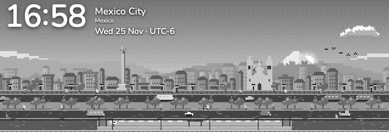 Monochrome</td>
<td>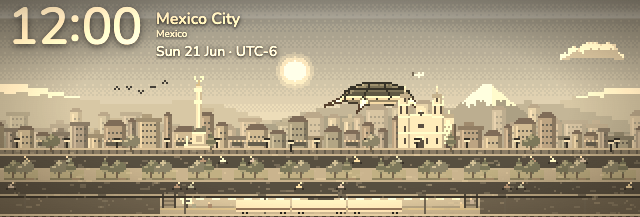 Sepia</td>
<td>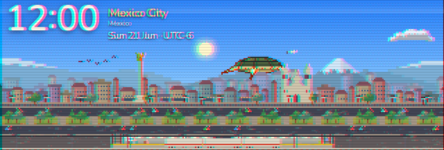 VHS</td>
</tr>
<tr>
<td>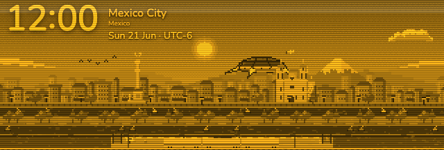 Amber terminal</td>
<td>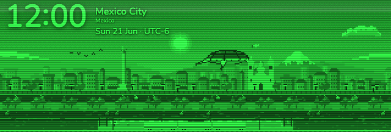 Green terminal</td>
<td>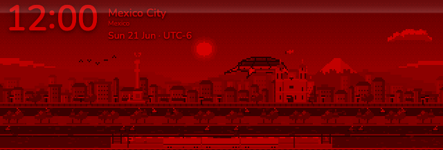 Night red</td>
</tr>
</table>

CRT makes each clock look like a small tube television, and LCD shows the thin gaps between the pixels of a handheld screen. Game Boy, CGA and EGA turn everything into the colours those machines had, the two terminals add scanlines to an amber or a green screen, and night red keeps a dim red picture for a dark bedroom. At night, Game Boy and CGA lift the dark parts before they pick a colour, so the sky, the skyline and the lit windows stay apart:

<table>
<tr>
<td width="33%">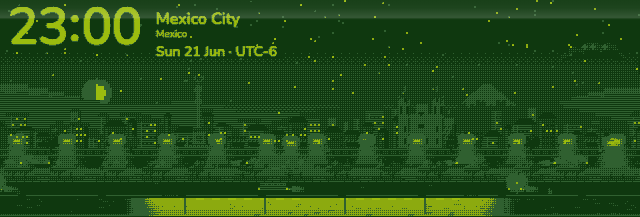 Game Boy at night</td>
<td width="33%">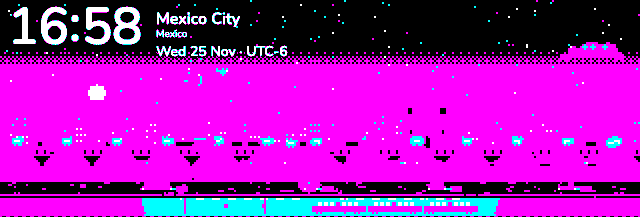 CGA at night</td>
<td width="33%">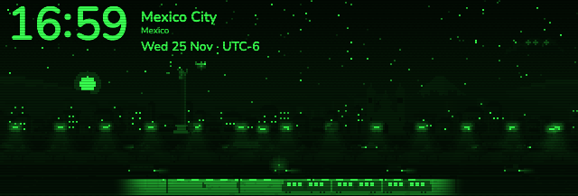 Green terminal at night</td>
</tr>
</table>

## Battery and screen care

The same SCREEN tab has three settings for leaving the clocks up for hours. **Battery saver** draws 5 frames a second instead of 15, so a phone stays cooler, and turning off **Keep the screen on** lets the screen dim and sleep as usual, which saves the most.

**Burn-in protection**, on by default, keeps OLED screens safe. The picture moves by a pixel or two every 2 minutes, so no pixel shows the same thing for hours, and a soft line sweeps down the screen every 10 minutes.

## Keys

| Key | What it does |
|---|---|
| **S** | Opens settings (cities, alarms, music, screen filter) |
| **F** | Full screen |
| **M** | Music on or off |
| **N** | Next song |
| **R** three times | The next kind of weather in every city, then the real weather again (on a touch screen, swipe up, down, up and down) |
| **E** three times | The next city event of the cities on screen, then the events at their real times again (on a touch screen, swipe left, right, left and right) |
| **G** | Plays the next event that comes round every hour or so in the cities on screen, such as Big Ben striking the hour, with its sound |
| **A** three times | Plays the test alarm from the ALARMS tab (on a touch screen, swipe down, up and down again) |
| **Esc** | Closes settings |

On a touch screen, tap to show the buttons. With a TV remote, the arrows move between the buttons and the settings, OK presses, Back closes settings, and the remote's play and next keys control the music. Left, Right, Left, Right on the clocks is the event test. A text box only opens the TV's keyboard once you press OK on it, so moving through settings doesn't keep popping it up.

There are a few easter eggs too. **K**eep poking and you'll maybe find some.

## For developers

Everything about how it works, how to run it, change it and fix it is in the [manual](MANUAL.md).

## Credits

- Font: [Nunito](https://github.com/googlefonts/nunito), SIL Open Font License 1.1, embedded in the page.
- The recorded bagpipe and Spanish classical guitar in the Celtic, Galician, flamenco, fado and bossa nova songs come from the [FreePats project](https://freepats.zenvoid.org/), both released under [CC0 1.0](https://creativecommons.org/publicdomain/zero/1.0/). The grand piano comes from Versilian Studios' [VCSL](https://github.com/sgossner/VCSL), also CC0 1.0. The [Bagpipe](https://freepats.zenvoid.org/Ethnic/bagpipe.html) was recorded by Gilles Sadowski, and the [Spanish classical guitar](https://freepats.zenvoid.org/Guitar/acoustic-guitar.html) by roberto@zenvoid.org. The soft grand piano in bossa nova is the Kawai grand of Versilian Studios' [Virtual Community Sample Library](https://github.com/sgossner/VCSL) (VCSL), also CC0 1.0. A few notes of each are embedded in the page, made smaller by `tools/samples.py`.
- Capital coordinates adapted from [countries_cities_data](https://github.com/katerinaSo/countries_cities_data). The other cities and the populations come from [GeoNames](https://www.geonames.org/) (CC BY 4.0), and the coastline used to find coastal cities from [Natural Earth](https://www.naturalearthdata.com/) (public domain). How the list was built is in [tools/atlas](../tools/atlas/README.md).
- Weather data by [Open-Meteo.com](https://open-meteo.com/), under [CC BY 4.0](https://creativecommons.org/licenses/by/4.0/). The place search uses Open-Meteo's geocoding, which is based on [GeoNames](https://www.geonames.org/) (CC BY 4.0). The page shows this credit above its buttons, and the **LICENSE** tab in settings has the details.
