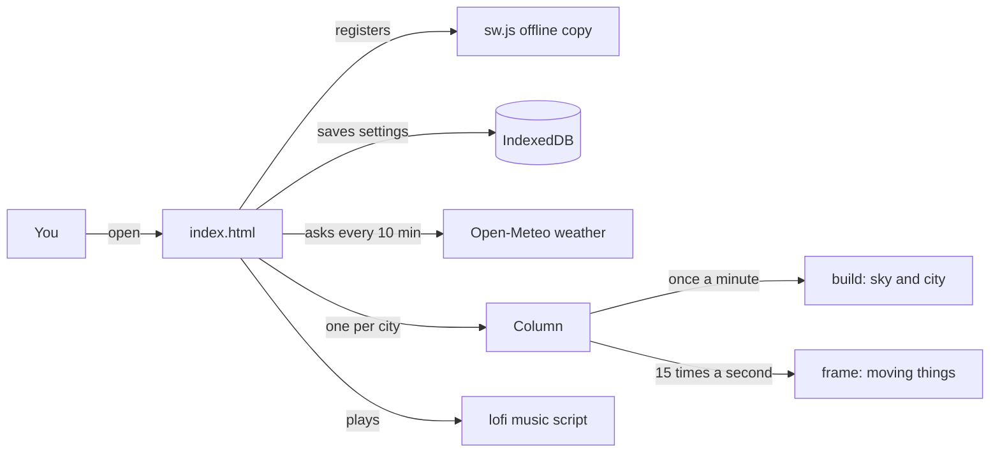
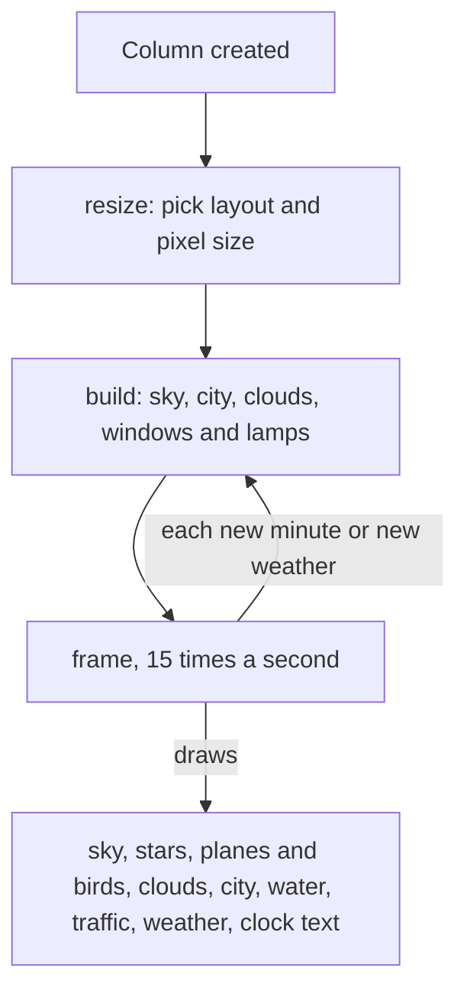

# Clockscapes manual

This manual is for anyone who wants to run, change or fix Clockscapes. You only need a terminal and a browser. The [README](../README.md) covers using the app.

## 1. What you have

Clockscapes is a web page that draws one pixel-art city per time zone, with a clock on top. All of the app is one file, `index.html`, holding the HTML, the CSS and the JavaScript. There's no build step, no framework and no dependency to install. Two small extra files make it installable and usable offline.

| File | What it is |
|---|---|
| `index.html` | The whole app: page, styles, drawing code, music, settings |
| `sw.js` | The service worker, which keeps a copy of the app so it opens offline |
| `manifest.webmanifest` | Name, icons and colours used when the app is installed |
| `icons/` | App icons (192 and 512 pixels) |
| `img/` | Pictures for the README only, not used by the app |
| `tests/music.test.js` | Tests for the music writer |

GitHub Pages publishes the `main` branch as it is, so whatever is on `main` is live at https://utopick.github.io/clockscapes/.

## 2. How the parts fit



Inside `index.html` the script is split into sections, each starting with a `// ==== Name ====` comment. Search for those headers to jump around.

| Section header | What lives there |
|---|---|
| `Config` | Default settings and `CITY_ATLAS`, the list of about 390 cities |
| `Astronomy` and `Lighting palette` | Sun and moon position, and the sky colours for each sun height |
| `Weather` | Talking to Open-Meteo and caching the answer |
| `Scene building blocks` | Buildings, streets, water, lamps, trees |
| `Atlas cities` and `Landmarks` | City colours, the landmarks of each city (`CITY_LANDMARKS`) and how each landmark is drawn (`cityLandmark`) |
| `Mountains on the horizon` | Far ranges (`MOUNTAINS`) and famous single peaks (`PEAKS`) |
| `Scene life` | Planes, birds, boats, trains, cars, bikes, people and dogs |
| `Encounters` | The giant monsters |
| `Alarms` | Alarm messages, trucks, marches, banner planes and the arpeggio |
| `Music` | Picking songs from your clocks (the song writer itself is `<script id="lofi">`) |
| `Column renderer` | `class Column`, which turns one city into a picture |
| `App` | Start-up, keys, gestures and the settings panel |

The comment at the top of the script explains the short names used everywhere: `g` is the canvas being drawn on and `e` is the scene's "environment" (its size, ground line, colours and random numbers).

This is how a single clock is drawn:



So far you have seen that the app is one file in named sections, and that each clock is a `Column` that builds a still picture once a minute and draws the moving things on top of it. Next, get it running.

## 3. Tutorial: run it and change it

You need Python 3 (already on macOS and most Linux) and a browser. Node is only needed for the tests.

1. Get the code and go into it:
   ```sh
   git clone https://github.com/utopick/clockscapes.git
   cd clockscapes
   ```
2. Start a small web server in that folder:
   ```sh
   python3 -m http.server 8000     # serves this folder at http://localhost:8000
   ```
3. Open http://localhost:8000 and you should see three clocks (Barcelona, New York and Sydney).
4. Try a fake night with rain by opening http://localhost:8000/?alt=-20&wx=rain. The `alt` value is the sun's height in degrees, so a negative number means night.
5. Make a change. Open `index.html`, search for `DEFAULT_CONFIG` and change `"Barcelona"` in the first `zones` entry to `"Barna"`.
6. Open the page in a private window (saved settings would otherwise win over the defaults) and the first clock now says Barna.
7. Undo the change with `git checkout index.html`.

You can also open `index.html` straight from the disk, but the offline copy and the install button only work when the page comes from a web server.

## 4. Everyday commands

```sh
python3 -m http.server 8000                         # run it locally at http://localhost:8000
node --test tests/music.test.js                     # test the music writer (5 tests, about 1 second)
npx -y prettier@3 --print-width 110 --write index.html   # format the file the way it is kept
npx -y prettier@3 --print-width 110 --check index.html   # check the format without changing it
git push origin main                                # publish: GitHub Pages rebuilds in about a minute
```

Handy addresses for trying things without waiting for the right time or weather:

| Address ending | What you see |
|---|---|
| `?alt=-10` | The sun 10° below the horizon, so dusk |
| `?wx=snow&i=0.9` | Heavy snow. Other weathers are `clear`, `partly`, `cloudy`, `fog`, `rain` and `thunder` |
| `?layout=rows` or `?layout=columns` | Forces the phone or the desktop layout |
| `?alarm=Hello there` | Shows that alarm message right away (`&style=trucks`, `march` or `planes` to choose) |
| `?enc=0` | Plays a monster encounter: 0 kaiju, 1 mecha, 2 turtle, 3 pterosaur, 4 spiked lizard, 5 three-headed dragon, 6 rose plant, 7 moth |
| `?fx=crt` or `?fx=lcd` | Shows a screen filter without saving it |

## 5. Where to fix things

| If you want to change… | Look in… | Watch out for… |
|---|---|---|
| The cities you can pick | `CITY_ATLAS` in the `Config` section | Each row is `[id, label, country code, lat, lon, time zone, style, art, capital]`. Never rename an `id`, because saved settings point to it |
| A city's landmarks | `CITY_LANDMARKS`, and `cityLandmark` for how a kind is drawn | Every city should keep at least two landmarks |
| Mountains behind a city | `MOUNTAINS` (ranges) and `PEAKS` (single famous peaks) | Only add mountains you can really see from the city |
| Trees in a city | `FLORA_OVERRIDES` and `cityFlora` | Trees follow the climate, so palms stay out of Oslo |
| Cars, trucks, police cars | `VEHICLE_MIX` in `Scene life` | The chances add up to 100 |
| Planes and birds | `drawSkyLife` | Gulls need the city in `SEASIDE` (or a scene with water) |
| Clouds | `cloudSprite` in `class Column` | Clouds are drawn once a minute, so keep them cheap |
| Sky colours | `PAL` in `Lighting palette` | Colours are `[r, g, b]` arrays |
| Alarm look and speed | `ALARM_STYLES`, `ALARM_DRAW` and `fireAlarm` | The alarm lane `SYNC_LANE` must line up in every city |
| Alarm sound | `ARP_CHORDS` and `alarmSound` | Browsers only allow sound after the first tap |
| Music | `<script id="lofi">` and the `Music` section | Run `node --test tests/music.test.js` after any change |
| Text layout (clock, city, country) | `resize` in `class Column` and the CSS at the top | Check both the phone (390 × 844) and a wide screen |
| Settings panel | `openSettings` in `App`, and `#modal` in the HTML | Saved settings must keep loading, so give new options a default in `DEFAULT_CONFIG` |
| Screen filters (CRT, LCD) | The CSS under "Screen filters" at the top, and `applyFilter` | They are CSS overlays on each clock, and the LCD grid uses `--px`, the clock's pixel size |
| Offline copy | `sw.js` | It always asks the network first, so normally nothing needs changing there |

## 6. FAQ and troubleshooting

**My phone still shows the old version after I pushed.** Pages takes about a minute to rebuild. After that, close the app completely and open it again. The service worker asks the network first, so one restart is enough.

**The clock says "Loading weather…" forever.** The page can't reach Open-Meteo, so you're offline or it's blocked. The scene still works with clear skies, and you can switch the weather off in settings.

**My settings disappeared.** Settings live in the browser's IndexedDB under the name `pixel-timezones`. A private window, clearing site data or a different browser starts fresh. Never rename that database in the code, or everyone's settings are lost.

**The music doesn't play.** Browsers block sound until you touch or click the page once. Tap the screen, then press MUSIC.

**An alarm didn't go off.** Alarms are checked once a second by the open page, so the page must be open (a background tab is fine, a closed one is not). They use the device's own time, not the clocks' time zones.

**How do I test an alarm without waiting?** Write a message in the test box in the ALARMS tab, then press A three times, or swipe down, up and down on the clocks.

**Where did the monster come from?** That's an encounter. They appear for 10 seconds at 00:00, 06:00, 12:00 and 18:00, and there are other ways to call them.

**The format check fails.** Run the Prettier `--write` command from section 4 and commit the result.

## 7. Words used in this project

| Word | Meaning |
|---|---|
| Column | One clock with its city scene (`class Column`) |
| Scene | The picture of one city. Atlas cities share a recipe and differ by style, colours and landmarks |
| Atlas | `CITY_ATLAS`, the list of cities you can pick |
| Style | The kind of scene a city uses: `harbor`, `island`, `ridge`, `metro`, `old`, `lush` or `desert` |
| Life | Everything that moves in a scene: traffic, people, boats, planes, birds |
| Sync lane | The road lane at the same height in every city (`SYNC_LANE`), where alarm processions drive from one clock into the next |
| Encounter | A giant monster visit |
| `e` | The scene environment passed to every drawing function |
| `alt` | The sun's height above the horizon in degrees |
