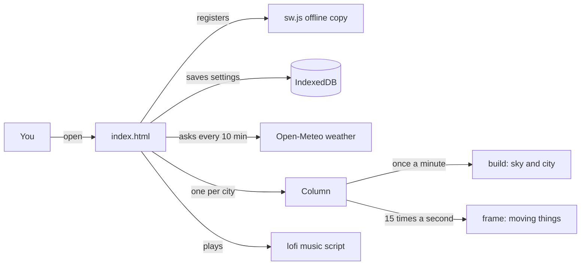
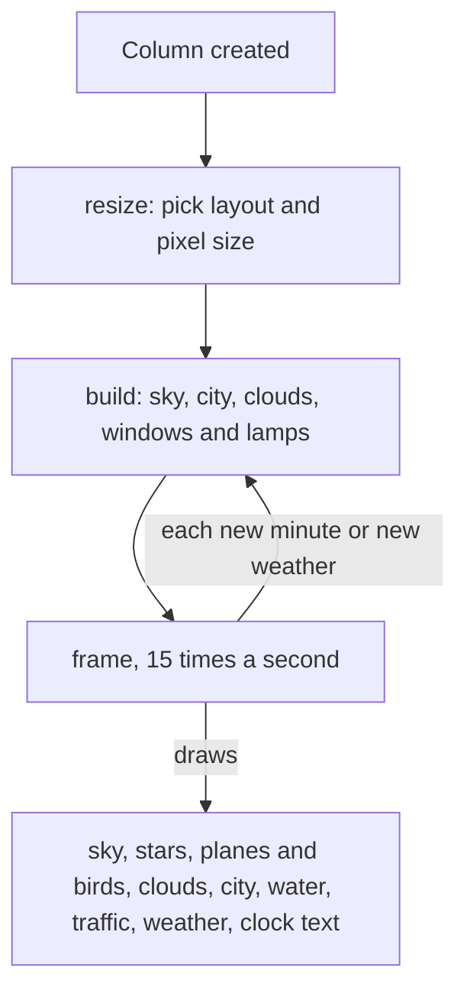

# Clockscapes manual

This manual is for anyone who wants to run, change or fix Clockscapes. You only need a terminal and a browser. The [README](../README.md) covers using the app.

## 1. What you have

Clockscapes is a web page that draws one pixel-art city per time zone, with a clock on top. All of the app is one file, `index.html`, holding the HTML, the CSS and the JavaScript. There's no build step, no framework and no dependency to install. Two small extra files make it installable and usable offline.

| File | What it is |
|---|---|
| `index.html` | The whole app: page, styles, drawing code, music, settings |
| `sw.js` | The service worker, which keeps a copy of the app so it opens offline |
| `manifest.webmanifest` | Name, icons and colours used when the app is installed |
| `icons/` | App icons (192 and 512 pixels) |
| `img/` | Pictures for the README only, not used by the app |
| `tests/music.test.js` | Tests for the music writer |
| `android/` | The Android app for phones, tablets, TVs and cars, which shows the same `index.html` in a web view |
| `native/` | The native music engine (`lofi.c`), used by the Android app and, built to WebAssembly by `tools/lofi-wasm.sh`, by the page |
| `.github/workflows/android.yml` | Builds the APKs on GitHub on every push to `main` |

Everything lives on the one `main` branch. GitHub Pages publishes it as it is, so whatever is on `main` is live at https://utopick.github.io/clockscapes/, and each push also builds the Android APKs (Actions, then Android APK, then the run's Artifacts).

## 2. How the parts fit



Inside `index.html` the script is split into sections, each starting with a `// ==== Name ====` comment. Search for those headers to jump around.

| Section header | What lives there |
|---|---|
| `Config` | Default settings and `CITY_ATLAS`, the list of about 3,000 cities with their populations |
| `Astronomy` and `Lighting palette` | Sun and moon position, and the sky colours for each sun height |
| `Weather` | Talking to Open-Meteo and caching the answer |
| `Scene building blocks` | Buildings, streets, water, lamps, trees |
| `Festivities` | Local and national holidays (`FESTIVALS`) and the date rules that find them |
| `Atlas cities` and `Landmarks` | City colours, the landmarks of each city (`CITY_LANDMARKS`) and how each landmark is drawn (`cityLandmark`) |
| `Mountains on the horizon` | Far ranges (`MOUNTAINS`) and famous single peaks (`PEAKS`) |
| `Scene life` | Planes, birds, boats, trains, cars, bikes, people and dogs, and how busy the streets are at each hour |
| `Encounters` | The giant monsters |
| `City events` | Real events at their local time, such as Austin's bats or the Eiffel Tower's sparkle (`EVENTS`, `CITY_EVENTS`) |
| `Alarms` | Alarm messages, trucks, marches, banner planes and the arpeggio |
| `Music` | Picking songs from your clocks (the song writer itself is `<script id="lofi">`) |
| `Column renderer` | `class Column`, which turns one city into a picture |
| `App` | Start-up, keys, gestures and the settings panel |

The comment at the top of the script explains the short names used everywhere: `g` is the canvas being drawn on and `e` is the scene's "environment" (its size, ground line, colours and random numbers).

This is how a single clock is drawn:



So far you have seen that the app is one file in named sections, and that each clock is a `Column` that builds a still picture once a minute and draws the moving things on top of it. Next, get it running.

## 3. Tutorial: run it and change it

You need Python 3 (already on macOS and most Linux) and a browser. Node is only needed for the tests.

1. Get the code and go into it:
   ```sh
   git clone https://github.com/utopick/clockscapes.git
   cd clockscapes
   ```
2. Start a small web server in that folder:
   ```sh
   python3 -m http.server 8000     # serves this folder at http://localhost:8000
   ```
3. Open http://localhost:8000 and you should see three clocks (Barcelona, New York and Sydney).
4. Try a fake night with rain by opening http://localhost:8000/?alt=-20&wx=rain. The `alt` value is the sun's height in degrees, so a negative number means night.
5. Make a change. Open `index.html`, search for `DEFAULT_CONFIG` and change `"Barcelona"` in the first `zones` entry to `"Barna"`.
6. Open the page in a private window (saved settings would otherwise win over the defaults) and the first clock now says Barna.
7. Undo the change with `git checkout index.html`.

You can also open `index.html` straight from the disk, but the offline copy and the install button only work when the page comes from a web server.

## 4. Everyday commands

```sh
python3 -m http.server 8000                         # run it locally at http://localhost:8000
node --test tests/music.test.js                     # test the music writer (23 tests, about 2 seconds)
npx -y prettier@3 --print-width 110 --write index.html   # format the file the way it is kept
npx -y prettier@3 --print-width 110 --check index.html   # check the format without changing it
git push origin main                                # publish: GitHub Pages rebuilds in about a minute
```

Handy addresses for trying things without waiting for the right time or weather:

| Address ending | What you see |
|---|---|
| `?alt=-10` | The sun 10° below the horizon, so dusk |
| `?wx=snow&i=0.9` | Heavy snow. Other weathers are `clear`, `partly`, `cloudy`, `fog`, `rain`, `drizzle`, `freezing`, `thunder`, `hail`, `grains`, `haze`, `dust`, `smoke`, `rainbow` and `aurora` (the list is `WX_TESTS`) |
| `?layout=rows` or `?layout=columns` | Forces the phone or the desktop layout |
| `?alarm=Hello there` | Shows that alarm message right away (`&style=trucks`, `march` or `planes` to choose) |
| `?enc=0` | Plays a monster encounter: 0 kaiju, 1 mecha, 2 turtle, 3 pterosaur, 4 spiked lizard, 5 three-headed dragon, 6 rose plant, 7 moth |
| `?fx=crt` or `?fx=lcd` | Shows a screen filter without saving it |
| `?fest=La Mercè` | A festival banner plane crosses every clock now, every 30 seconds |
| `?event=sparkle` | Shows that city event now (a name in `EVENTS`) in the clocks whose city has it. E three times steps through them instead |

## 5. Where to fix things

| If you want to change… | Look in… | Watch out for… |
|---|---|---|
| The cities you can pick | `CITY_ATLAS` in the `Config` section | Each row is `[id, label, country code, lat, lon, time zone, style, art, capital]`. Never rename an `id`, because saved settings point to it |
| A city's landmarks | `CITY_LANDMARKS`, and `cityLandmark` for how a kind is drawn | Only draw a city's real sights, one or two of them; a city with no famous sight keeps the generic skyline, which grows with its population |
| Mountains behind a city | `MOUNTAINS` (ranges) and `PEAKS` (single famous peaks) | Only add mountains you can really see from the city |
| Trees in a city | `FLORA_OVERRIDES` and `cityFlora`, with the seasons in `plantKind` and `leafSeason` | Trees follow the climate, so palms stay out of Oslo. Away from the tropics they are bare in winter, blossom in spring and turn in autumn, flipped in the southern hemisphere |
| The ground (street, park, railway, water) | `ground` and `street` | Every city calls `ground`, so the bands line up when clocks stand side by side. Don't give one city its own street |
| Cars, trucks, police cars, taxis | `VEHICLE_MIX` and `VEHICLE_HALF` in `Scene life`, drawn in `drawGroundLife` | The chances add up to 100. Each car rolls a new kind every time it crosses the screen |
| Boats | `BOAT_MIX` and the boat loop in `drawGroundLife` | The chances add up to 100. Boats only appear where the scene has water |
| Trains | `TRAIN_KINDS` (looks and speed), `TRAIN_LINES` (which country runs which trains), `railway` (the track, wires and station) and `drawTrain` | Inland cities have a railway in the bottom band. Capitals and big metro cities also get overhead wires and a station where passenger trains stop. Coastal cities in `TRAIN_LINES` get a raised line instead |
| How busy the streets are | `busyness` and `CROWDS` in `Scene life` | `busyness` uses the city's local weekday and hour. `CROWDS` turns the city's population into one of four levels (few people, more people, crowded, super crowded), and both multiply the cars and walkers of a normal hour |
| The list of cities | `CITY_ATLAS`, built with `tools/atlas/build.py` | Never rename an id, because saved settings point to it. The last field of a row is the population. The scripts read GeoNames and Natural Earth files you download yourself, and their README says how |
| Holidays and festivals | `FESTIVALS` in `Festivities` | Rules look like `"07-14"`, `"03-15+4"` (and 4 more days), `"E-47"` (days from Easter) or `"11/4/Thu"` (fourth Thursday). The dates of Lunar New Year (`LUNAR_NEW_YEAR`), Diwali (`DIWALI`) and Eid (`EID`, in `City events`) follow the moon and end in 2030, so add the next years before then |
| City events | `EVENTS` and `CITY_EVENTS` in `City events` | An event says when it happens (months, weekdays, a festival-style date rule, hours, set times or every N minutes, the sun's height) and how it shows: a `draw` function in the `back`, `front` or `street` layer, a `life` function that changes the traffic, or `freeze`. `also` gives it parts in other layers (the Cabalgata's fireworks behind the city, New Year's banner in front), and `at` can be a function of the scene, as the call to prayer's `prayerTimes` is. A procession marked `parade: true` comes in from the left and crosses the whole screen again and again (`paradeHead`), and the event test lets it run instead of starting it over every 40 seconds (`testLen` sets another loop for events longer than that). `road: true` keeps the cars out of the first lane while the event is on, and `quietWith` silences an event's sound while another one plays (New Year's bells give way to the Puerta del Sol chimes in Madrid). To see every event in one place, type `atlantis` on the clocks, swipe down three times and then right three times, or press Down three times and Right three times on a remote. That opens Atlantis, a hidden harbour city with water, a deep street and landmarks, which plays every event two seconds each until a tap stops it; the same code brings your cities back. Carnival parades come from `FESTIVALS`: any city whose festival is a carnival gets one, so a new carnival is only a new festival entry. Only add things that really happen there, at the time they really happen. A `sound` plays only while the music and its city sounds are on |
| Planes and birds | `drawSkyLife` | Gulls need the city in `SEASIDE` (or a scene with water) |
| Clouds | `cloudSprite` in `class Column` | Clouds are drawn once a minute, so keep them cheap |
| Sky colours | `PAL` in `Lighting palette` | Colours are `[r, g, b]` arrays |
| Alarm look and speed | `ALARM_STYLES`, `ALARM_DRAW` and `fireAlarm` | The alarm lane `SYNC_LANE` must line up in every city |
| Alarm sound | `ARP_CHORDS` and `alarmSound` | Browsers only allow sound after the first tap |
| Music | `<script id="lofi">` and the `Music` section | Run `node --test tests/music.test.js` after any change |
| Regional music | `STYLES`, `MODES`, `OWN_REGIONS` and `REGIONS` in `<script id="lofi">`, `moodAt` in `Music` | A style is a small recipe that bends a lo-fi song towards a place: its scales (`modes`), fixed chords (`prog`), a tempo range, voices that replace the band's, a melody voice with grace notes, a drone, a strummed chord, hand drums and an ostinato. `moodAt` passes the first clock's style in `mood.region` (none when the MUSIC tab's Regional music box is off), and without a style a song is exactly the plain one, which the test checks. Places live in two tables: `OWN_REGIONS`, picked by hand and checked first, and `REGIONS`, which `python3 tools/lofi-regions.py regional-instruments.tsv` writes from the research table, mapping its `lo-fi style` column to the styles built so far (the others play plain lo-fi). The script also holds the owner's changes to the table: `WHOLE` gives a country one style everywhere (Turkey, the Persian and steppe countries), `COUNTRY_ONLY` changes only a country's own row (the United States, Canada and Australia stay plain while Texas and Nashville play country), `RETARGET` swaps a country's style in all its rows (Slavic folk for the table's polka in Russia, Ukraine and Belarus), and `REGION_STYLE` sets single regions (the Andes). Its pattern only matches the table's own lines, so it can't run past the table's end. To add a style, add a row to `STYLES`, map it in the script's `STYLE_OF` and run the script again. A style that needs a new sound needs a new voice in both the Player and `lofi.c` |
| The kaiju song | `STYLES.kaiju` in `<script id="lofi">`, `kaijuMusic` in `Music` | While a monster is on any clock, `kaijuMusic` (called by `musicTick`) fades into `LOFI.song(seed, { kaiju: true })`, a slow tread in D (66 to 74 bpm) built from the same machinery as any song, and back into a new lo-fi song when the encounter is over. Its key is fixed so that its motto, three brass notes in fifths and octaves (`fanfare` in `STYLES.kaiju`), sounds the same at the start of every section of every kaiju song; the tune and chords between come from the seed. Several clocks starting the same encounter switch the music once, since `music.kaiju` remembers it. Its motto, ostinato and tread are written for this page: keep any change original, and if a figure reminds you of a film's theme, change it. Keep it no louder than about 1.3 times a plain song |
| The native music engine | `native/lofi.c`, played by `NativeMusic.kt` in the app and by `script#lofi-wasm` in a browser | Songs are written in `<script id="lofi">` but played by default by this C engine: natively in the Android app, and compiled to WebAssembly in an AudioWorklet in a browser (the MUSIC tab's "Sound engine" can pick Web Audio, the original `LOFI.Player`). A voice changed or added in `<script id="lofi">` must be changed in `lofi.c` too, where each voice has the same name, and after any change to `lofi.c` run `sh tools/lofi-wasm.sh` (it needs Emscripten, `brew install emscripten`) to rebuild the page's copy. The music test fails when `lofi.c` doesn't know a voice or the page's copy is older than `lofi.c`. To hear a song from it on a computer, build it with `cc -O2 -DLOFI_CLI native/lofi.c -o lofi -lm` and run `./lofi song.txt out.wav 30` |
| Text layout (clock, city, country) | `resize` in `class Column` and the CSS at the top | Check both the phone (390 × 844) and a wide screen |
| Settings panel | `openSettings` in `App`, and `#modal` in the HTML | Saved settings must keep loading, so give new options a default in `DEFAULT_CONFIG` |
| Screen filters (CRT, LCD) | The CSS under "Screen filters" at the top, and `applyFilter` | They are CSS overlays on each clock, and the LCD grid uses `--px`, the clock's pixel size |
| Frame rate, keeping the screen on | `loop` and `keepAwake` in `App`, the `power` and `awake` settings | The loop sleeps between frames on a timer; don't go back to running on every screen refresh, which costs battery |
| Burn-in protection | `screenCare` and `CARE_SPOTS` in `App`, and the `.sweep` CSS | The shift stays within 2 CSS pixels so nothing gets cut off |
| Offline copy | `sw.js` | It always asks the network first, so normally nothing needs changing there |

## 6. FAQ and troubleshooting

**My phone still shows the old version after I pushed.** Pages takes about a minute to rebuild. After that, close the app completely and open it again. The service worker asks the network first, so one restart is enough.

**The clock says "Loading weather…" forever.** The page can't reach Open-Meteo, so you're offline or it's blocked. A city that has had weather before keeps showing its last known weather, and one that never had any shows a clear sky. You can also switch the weather off in settings.

**My settings disappeared.** Settings live in the browser's IndexedDB under the name `pixel-timezones`. A private window, clearing site data or a different browser starts fresh. Never rename that database in the code, or everyone's settings are lost.

**The music doesn't play.** Browsers block sound until you touch or click the page once. Tap the screen, then press MUSIC.

**An alarm didn't go off.** Alarms are checked once a second by the open page, so the page must be open (a background tab is fine, a closed one is not). They use the device's own time, not the clocks' time zones.

**How do I test an alarm without waiting?** Write a message in the test box in the ALARMS tab, then press A three times, or swipe down, up and down on the clocks.

**Why is a plane towing a banner over one city?** It's that city's holiday or festival today, from the `FESTIVALS` table. It flies at :00, :15, :30 and :45 local time. To add a festival, add a row for the city id (such as `"madrid-es"`) or the country code (such as `"ES"`).

**Why are there bats (or kites, or fireworks) over a city?** That's a city event, something that really happens there at that local time, from the `EVENTS` table. Press E three times to step through the events of the cities on screen, and once more after the last one to go back to real times.

**The traffic looks thin.** It follows the city's local time, so it may be the middle of the night there, or a weekend. See `busyness` to change it.

**Where did the monster come from?** That's an encounter. They appear for 10 seconds at 00:00, 06:00, 12:00 and 18:00, and there are other ways to call them.

**My phone gets hot.** The screen kept on at full brightness, the music and the drawing all add up. In SCREEN, pick Battery saver and let the screen sleep. The CRT filter also costs a little more, since the browser blurs the picture on every frame.

**The format check fails.** Run the Prettier `--write` command from section 4 and commit the result.

## 7. Words used in this project

| Word | Meaning |
|---|---|
| Column | One clock with its city scene (`class Column`) |
| Scene | The picture of one city. Atlas cities share a recipe and differ by style, colours and landmarks |
| Atlas | `CITY_ATLAS`, the list of cities you can pick |
| Style | The kind of scene a city uses: `harbor`, `island`, `ridge`, `metro`, `old`, `lush` or `desert` |
| Life | Everything that moves in a scene: traffic, people, boats, planes, birds |
| Sync lane | The road lane at the same height in every city (`SYNC_LANE`), where alarm processions drive from one clock into the next |
| Encounter | A giant monster visit |
| Lap | One crossing of the screen by a car, boat or train. Each lap rolls a new kind, so the same car can come back as a taxi |
| Festival | A local or national holiday from `FESTIVALS`, shown as a banner plane and fireworks at night |
| City event | Something that really happens in a city at its local time, from `EVENTS` (bats, a cannon, a fountain show, kites) |
| `e` | The scene environment passed to every drawing function |
| `alt` | The sun's height above the horizon in degrees |
